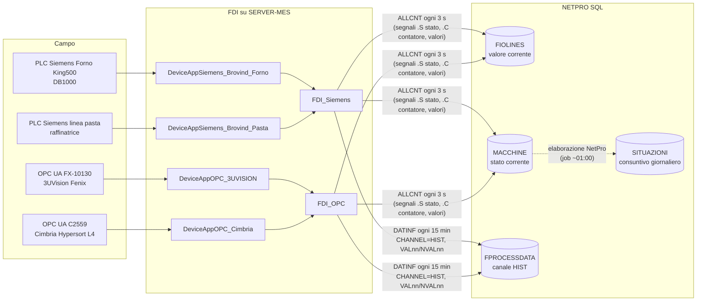
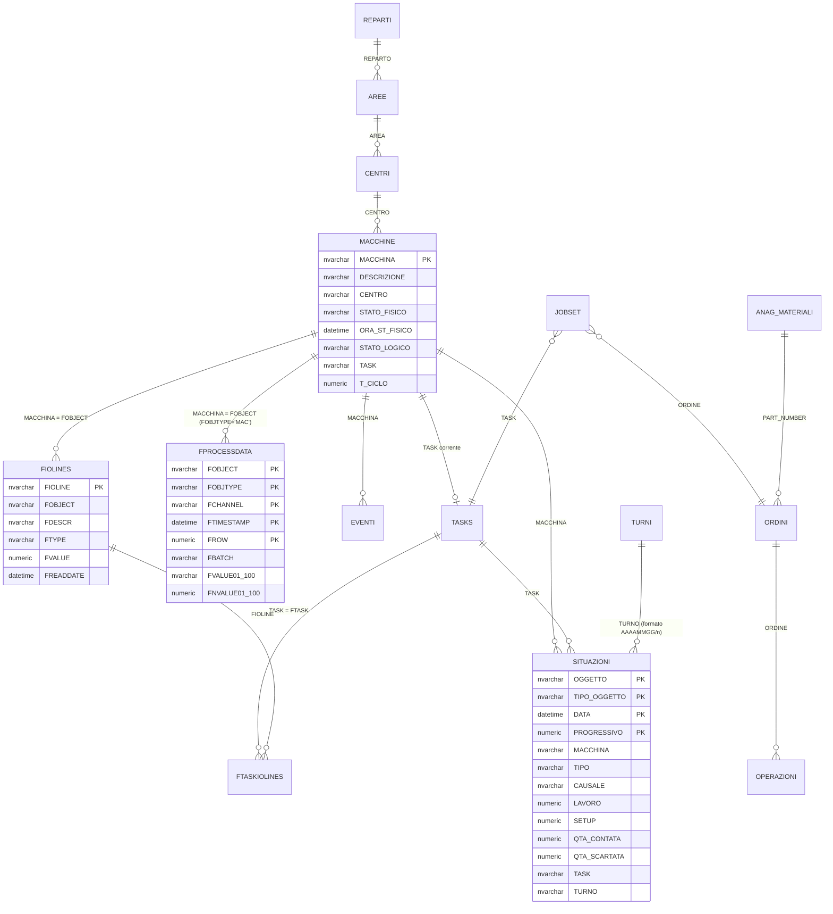

# 01 — Mappa del database MES (Qualitas NetPro)

Stato: **approvata il 05/11/2026** (con le risposte riportate in §11)

Fonti:
- query in sola lettura `discovery/sql` (giro 1) e `discovery/sql_giro2` (giro 2) sul DB `NETPRO`;
- file di configurazione FDI (`Config.json` / `Config.xml`, credenziali oscurate) in `\\192.168.3.205\c$\Qualitas\NetPro\FDI`.

Nessun nome di operatore è riportato in questo documento. I dati riportati sono quelli letti: nessun valore è stato arrotondato o interpolato.

Legenda:
- **[VERIFICATO]**: letto nei dati o nei file di configurazione;
- **[DEDOTTO]**: ricavato dai nomi o dalla coincidenza dei valori, da confermare;
- **[DA VERIFICARE]**: domanda aperta.

---

## 1. Sintesi

1. NetPro, in questo stabilimento, è usato soprattutto come **raccoglitore di segnali macchina** tramite FDI. Non è usato come MES di consuntivazione.
   - Ordini, task e consuntivi esistono, ma sono pochi e quasi tutti di test.
   - Le causali di fermo non sono configurate.
2. Per le 4 macchine i dati storici utilizzabili sono in **`FPROCESSDATA`**, canale `HIST`, con **una fotografia ogni 15 minuti** (timer FDI `TIMERHIST` = 900.000 ms). Il significato di ogni colonna è ora **noto dai file FDI**: vedi §4.
3. I valori correnti, aggiornati ogni 3 secondi, sono in **`FIOLINES`** (un record per segnale) e in **`MACCHINE`** (stato fisico/logico). **Non esiste uno storico degli stati a 3 secondi** in NETPRO.
4. **CCP**: NetPro non contiene limiti, esiti, deviazioni o azioni correttive (tabelle qualità vuote). Il candidato CCP più evidente è il forno **FORNOKING500**, con le temperature di tostatura ed essiccazione registrate ogni 15 minuti.
5. **OEE**: con i soli dati attuali l'OEE è calcolabile solo in modo approssimato:
   - risoluzione di 15 minuti;
   - stato macchina disponibile solo per alcune macchine;
   - nessuna velocità nominale o tempo ciclo affidabile;
   - nessuna causale di fermo.

   Le alternative sono in §9 e vanno decise in Fase 2.

---

## 2. Contesto tecnico [VERIFICATO]

| Voce | Valore |
|---|---|
| Istanza | `SERVER-MES\SISTEMI` (`192.168.3.205\sistemi`) |
| DBMS | SQL Server 2016 SP3 **Express** (13.0.6300.2), Windows Server 2019. Limite di 10 GB per database. |
| Database | `NETPRO` (letto) e `MACCHINE` (letto dal 05/11/2026, stessi permessi in sola lettura): vedi §5-bis |
| Collation | DB `Latin1_General_CI_AS`; server `…_CI_AI` |
| Ora | Locale (Europe/Rome), colonne `datetime` **senza offset** |
| Utente `lettore` | `db_datareader` + `db_denydatawriter`; permessi `CONNECT`, `SELECT` → **sola lettura dimostrata** |
| Oggetti | 321 tabelle, 0 viste, 0 procedure, 0 foreign key dichiarate |

---

## 3. Flusso dei dati [VERIFICATO dai file FDI]

- `ALLCNT` aggiorna il valore corrente di ogni segnale (`FIOLINES.FVALUE`, `FREADDATE`) e lo stato macchina (`.S`).
- `DATINF` inserisce una riga in `FPROCESSDATA`: `VALnn` → `FVALUEnn` (testo), `NVALnn` → `FNVALUEnn` (numerico), `BATCH` → `FBATCH`.
- `SITUAZIONI` è generata da NetPro (`FINSDATE` ≈ 01:00 del giorno dopo): una riga per giorno, macchina e task, con le ore `LAVORO`/`SETUP` e il `TIPO` (`IDLE`, `WORK`, `WSET`, `SET`, `TIME`).

---

## 4. Mappa di FPROCESSDATA per macchina [VERIFICATO]

Chiave primaria (cluster): `FOBJECT, FOBJTYPE, FCHANNEL, FTIMESTAMP, FROW`. Per le 4 macchine esiste il solo canale `HIST`, con `FOBJTYPE = 'MAC'`.

### FORNOKING500 — Forno Brovind King500 (PLC `FORNOKING`)
Dal 03/10/2023; circa 96 righe al giorno.

| Colonna | Variabile PLC | Significato (da `FIOLINES`) |
|---|---|---|
| `FBATCH` | `CODICE_ORDINE` | codice ordine sul PLC |
| `FVALUE01` | `Temp_Drying` | temperatura di essiccazione (`TDRY`) |
| `FVALUE02` | `Temp_Toasting` | **temperatura di tostatura** (`TTOST`) |
| `FVALUE03` | `Temp_Cooling` | temperatura di raffreddamento (`TCOOL`) |
| `FVALUE04` | `Temp_Cyclone` | temperatura ciclone (`TCYCL`) |
| `FVALUE05` | `Temp_Prod1` | temperatura prodotto 1 (`TPRO1`) |
| `FVALUE06` | `Temp_Prod2` | temperatura prodotto 2 (`TPRO2`) |
| `FVALUE07` | `STATO_MACCHINA` (in realtà `STATO_ORDINE` PLC, vedi A9) | 0 = ordine inviato, 1 = in lavorazione, 2 = terminato; **non è lo stato di marcia** |

Verifica: alle 13:01:58 del 05/11/2026, `FVALUE01–06` = 42,2 / 48,9 / 21,8 / 17,2 / 40,6 / 30,8. Nello stesso momento `FIOLINES` riportava TDRY 42,2 / TTOST 48,8 / TCOOL 21,8 / TCYCL 17,2 / TPRO1 40,5 / TPRO2 30,8.

Variabili lette dal PLC ma **non** storicizzate: `Time_Permanence` (tempo di permanenza **impostato**), `BulkHead_Opening`, `NOME_RICETTA`, `LOTTO`, `CODICE_ARTICOLO`. Il forno ha 56 ricette (elenco `RicetteForno_2026_09_25.xlsx`), ma **la ricetta in uso non è nello storico**.

**Il forno non espone un segnale di marcia/fermo**: il tempo in funzione va dedotto dalle temperature (vedi `02_definizioni_kpi.md`).

### BROVRAF — Raffinatrice Brovind linea pasta (PLC `L_PASTA`)
Dal 03/10/2023. **Tutti i valori a 0**; l'ultima lettura in `FIOLINES` è del 13/05/2025 `[DA VERIFICARE: PLC non collegato?]`.

| Colonna | Variabile PLC | Significato |
|---|---|---|
| `FBATCH` | `CODICE_ORDINE` | codice ordine |
| `FVALUE01` / `02` | `Temp_Prod_Ref1` / `Ref2` | temperatura prodotto raffinatrice 1 / 2 |
| `FVALUE03` / `04` | `Temp_Acqua_Ref1` / `Ref2` | temperatura acqua 1 / 2 |
| `FVALUE05` / `06` | `Vel_Pump_Ref1` / `Ref2` | velocità pompa 1 / 2 |
| `FVALUE07` / `08` | `Vel_Motor_Ref1` / `Ref2` | velocità motore 1 / 2 |
| `FVALUE09` / `10` | `Lev_Deposit_Ref1` / `Ref2` | livello deposito 1 / 2 |
| `FVALUE11` | `STATO_MACCHINA` | stato grezzo PLC |

### FX10130 — Selezionatrice ottica Fenix 3UVision (OPC UA)
Dal 14/02/2024; **righe irregolari** (52 negli ultimi 7 giorni invece di 672) `[DA VERIFICARE]`.

| Colonna | Variabile OPC | Significato |
|---|---|---|
| `FBATCH` | `CurrentRecipe` | ricetta/programma in uso |
| `FVALUE01` | `CurrentSmState` | stato macchina in testo. Valori da manuale: `Selecting` (in selezione), `Ready`, `ReadyError`, `Cleaning` (pulizia, anche ciclica durante la selezione), `Emergency`, `Offline`, `Configure`, `Connect`, `MachineData`, `Recipe`, `Setup`, `FwUpgrade` e varianti `…Error` |
| `FVALUE02` | `RegulatorPressureString` | pressione aria in testo ("3,97 bar") |
| `FVALUE03` / `04` | `S1_` / `S2_HopperLevel` | livello tramoggia sez. 1 / 2 (`EMPTY`/`LOW`/`FULL`) |
| `FNVALUE01` / `02` | `S1_` / `S2_PortataKgOra` | portata kg/h sezione 1 / 2 |
| `FNVALUE03` / `05` | `S1_` / `S2_RejectedProductKg` | kg scartati sez. 1 / 2 (contatore) |
| `FNVALUE04` / `06` | `S1_` / `S2_SelectedProductKg` | kg selezionati sez. 1 / 2 (contatore) |
| `FNVALUE07` | `RejectedProductKg` (calcolata) | kg scartati totali — **vedi anomalia A2** |
| `FNVALUE08` | `SelectedProductKg` (calcolata) | kg selezionati totali = S1 + S2 |
| `FNVALUE09` / `10` | `S1_` / `S2_RejectPercent` | % scarto sez. 1 / 2 |
| `FNVALUE11` / `12` | `S1_` / `S2_HopperAnalogLevel` | livello tramoggia analogico 1 / 2 |

### HYPERSORTL4 — Selezionatrice Cimbria Hypersort L4 (OPC UA `C2559`)
Dal 03/10/2023. **Valori vuoti**; ultima lettura dei segnali in `FIOLINES` il 28/01/2026 (connessione OPC assente o macchina ferma).

| Colonna | Variabile OPC | Significato |
|---|---|---|
| `FBATCH` | `RICETTA_ON` | ricetta in uso |
| `FVALUE01–03` | `KG_H_CH1–3` | kg/h canali 1–3 |
| `FVALUE04–06` | `VELV1–3` | velocità vibratori 1–3 `[DEDOTTO]` |
| `FVALUE07` | `STATO` | stato grezzo (0 = fermo, secondo la formula `STATO_CLC`) |

### Formato dei valori
- `FVALUEnn` è `nvarchar(200)`: i numeri sono **testo con la virgola decimale** ("42,2"). Vanno convertiti in decimale **senza arrotondare**, conservando il testo originale per la tracciabilità.
- `FNVALUEnn` è `numeric(15,5)`.

---

## 5. Classificazione delle tabelle

Le righe sono stimate dai metadati. Sono elencate solo le tabelle rilevanti; le altre ~280 sono vuote (moduli NetPro non usati).

### Anagrafiche
| Tabella | Righe | Uso | Note |
|---|---|---|---|
| `MACCHINE` | 26 | **sì** | `MACCHINA` (PK), `DESCRIZIONE`, `CENTRO`, `STATO_FISICO`/`ORA_ST_FISICO`, `STATO_LOGICO`/`ORA_ST_LOGICO`, `TIPO_RILEVAZIONE`, `TASK` corrente, `T_CICLO` (vuoto o non significativo per le 4 macchine), `FCODE01` (stato testuale FX10130) |
| `FIOLINES` | 57 | **sì** | anagrafica dei segnali con descrizione e valore corrente: `FIOLINE` = `<MACCHINA>.<SEGNALE>`, `FOBJECT`, `FDESCR`, `FTYPE` (CNT/CNTR/LINE), `FVALUE`, `FREADDATE` |
| `CENTRI` | 8 | sì | centri di lavoro (es. `MISCRAFF_01`, `SELEZIONATRICI`, `INVASETIC_01`) → utilizzabili come "linea" `[DA VERIFICARE]` |
| `AREE` / `REPARTI` / `AZIENDE` | 4 / 2 / 1 | sì | gerarchia organizzativa |
| `TURNI` | 4 | parziale | configurato solo il turno 2 "mattutino" 7–16 lun–ven, 7–13 sabato; turni 3–4 vuoti |
| `ANAG_MATERIALI` | 49 | parziale | articoli |
| `VALORI_TABELLE` | 77 | parametri | parametri di sistema; **nessuna causale di fermo**, solo `MATCAUSALI` (scarti) |
| `FRTSIGNALS` | 18 | riferimento | catalogo dei segnali real time (`MACON`, `MACOFF`, `APEWRK`, `PZPRO`, `PZSCA`…) |
| `FTASKIOLINES` | 6 | parziale | legame segnale ↔ task (solo FX10130 e PELAB) |

### Eventi macchina
| Tabella | Righe | Uso | Note |
|---|---|---|---|
| `EVENTI` | ~1.400 | scarso | solo aperture e chiusure di sessione (`OPN`, `CLS`, `UPD`, `SET`, `SUSS`) dal web service; nessuna causale |
| `STATI_MACCHINE`, `STO_EVENTI`, `FALARMS` | 0 | no | vuote |
| `MACCHINE.STATO_FISICO` | — | sì | **solo lo stato corrente** (nessuno storico) |

### Produzione
| Tabella | Righe | Uso | Note |
|---|---|---|---|
| `FPROCESSDATA` | ~2,1 mln | **sì** | vedi §4 |
| `SITUAZIONI` | ~25.000 | scarso | consuntivo giornaliero per macchina/task, `TIPO` ∈ {IDLE, WORK, WSET, SET, TIME}, `LAVORO`/`SETUP` in ore, quantità quasi sempre a 0, `CAUSALE` sempre vuota |
| `ORDINI` / `OPERAZIONI` / `TASKS` / `JOBSET` | 59 / 69 / 67 / 67 | scarso | ordini perlopiù di test. FX10130 ha un task fisso (`00006010`) aperto dal 27/01/2025: per questo `SITUAZIONI` registra 24 h/giorno `TIME`/`WORK` |
| `FXDECLAREDQTY` | 114 | scarso | dichiarazioni di quantità |
| `LOTTI`, `FS_MATERIALS`, `MOVIMENTI` | 2.802 / 2.467 / 94 | fuori perimetro | tracciabilità lotti |

### CCP / Qualità
| Tabella | Righe | Note |
|---|---|---|
| `FVALLIMITS` (limiti min/max per oggetto e variabile) | **0** | struttura adatta ai limiti CCP, ma vuota |
| `FTESTS`, `FTESTPLANS`, `FSPCMASTER`/`FSPCROWS`, `FCHARTXR_DATA`, `FSAMPLEDATA` | 0 | moduli qualità/SPC non usati |
| `FCHARTXR_DEFAULTS`, `FAQLRANGE`, `FINSPECTIONLOTSIZES` | 24 / 176 / 105 | solo tabelle di costanti (carte X-R, AQL) |

---

## 5-bis. Database `MACCHINE` [VERIFICATO, giro 3]

17 tabelle `*_IMP`, tutte con colonne `nvarchar` (date e numeri in testo), caricate da AppDBI (`AppDBI_Browind`, `AppDBI_Silos`, `AppDBI_FMT`). Nessuna vista, procedura o FK.

| Tabella | Righe | Periodo | Contenuto |
|---|---|---|---|
| `K800F_IMP` | 20.838 | **08/01/2022 – 31/01/2022** | Forno Brovind, **una riga al minuto**: `RecipeROASTER`, `LOTTO`, `SetpointC`, `ToastingC`, `DryingC`, `Product1C`, `Product2C`, **`TimeToasting`**, `LoadingBulkheadmm`, ventole %, `GasValvePercent`, mixer, `status` (sempre `Running`) |
| `K800P_IMP` | 19.104 | 10/01/2022 – 31/01/2022 | Raffinatrici 1 e 2: ricetta, lotto, stato, velocità %, temperature prodotto e acqua, livello deposito |
| `SILOS8…14CR_IMP` | ~52.000 ciascuna | es. SILOS8: 20/09/2022 – 31/03/2023 | temperatura silos crema (`DATAn`, `ORAn`, `MILLISECONDIn`, `TEMPn`) |
| `SILOS8…14PP_IMP` | ~90.000 ciascuna | es. SILOS8: 09/12/2022 – 05/07/2023 | come sopra; valori **corrotti** in alcune righe |
| `FMT_IMP` | 13 | 10/11/2022 – 30/11/2022 | ordini di prova linea FMT |

Conclusioni:
- Sono **import di avviamento o di test**: lotti `PROVA`, ricetta cooler `prova`, nessun dato dopo il 2023. **Non sono una fonte viva** per la dashboard.
- **Fonte dei dati** (da `AppDBI_Browind\xml\Config.xml` e `AppDBI_Silos\xml\Config.xml`) [VERIFICATO]:
  - forno: file `\\192.168.3.10\Forno\ArchiveKing800*.CSV`, separatore `;`, prime 2 righe saltate, import ogni 30 s;
  - raffinatrici: `\\192.168.3.10\Pasta\ArchivePasteLine*.CSV`;
  - silos: `\\192.168.3.10\Mes\IP_SilosPastapura192.168.3.241\datalog` e `…242\datalog` (`PP-Sn*.CSV`);
  - in tutti i casi `DeleteFile = true`: **FDI cancella i CSV dopo l'import**.

  Verifica del 05/11/2026 su `192.168.3.10`, che è un NAS:
  - `\\Forno\BK` contiene archivi **mensili** `ArchiveKing800_<mese>_<anno>.csv` da 11/2021 a **07/2022** (≈ 1,3–3,5 MB ciascuno);
  - `\\Pasta\BK` contiene `ArchivePasteLine_<mese>_<anno>.csv` da 11/2021 a **09/2022**;
  - dopo quelle date **non arrivano più file**;
  - `\\Forno\PowerBILink` e `\\Forno\MagicBoxElaborato` contengono Excel gestionali (ordini, food cost, giacenze, `Q_ElencoNC3tre.xlsx`), **non** log del forno.

  Conclusione: **oggi non esiste un log al minuto del forno disponibile in rete**. Il supervisore Brovind potrebbe però continuare a scrivere l'archivio mensile in locale. `[DA VERIFICARE con Brovind]`
- Quindi il **supervisore Brovind ha registrato (almeno nel 2022) un log al minuto con lotto, ricetta, temperatura e tempo di tostatura**, cioè il dato tipico di un CCP di tostatura. Se quel log è ancora attivo sul supervisore (export CSV letto da `AppDBI_Browind`), potrebbe diventare la fonte CCP del forno. `[DA VERIFICARE con il Config.xml di AppDBI_Browind]`
- Le ricette viste (`split calif`, `rottame iran`, `sgusciato nutw`, `Tostatura forte`, `sicilia mec`, `mandorla pelata`, `lavaggio`…) mostrano che i parametri CCP dipendono dalla ricetta/prodotto: i limiti dovranno essere **per ricetta**.

---

## 6. Relazioni (diagramma ER)

Non ci sono foreign key dichiarate. Le relazioni sotto sono **[DEDOTTE]** dai nomi e dai valori, da confermare.

---

## 7. Colonne chiave per OEE e CCP

| Esigenza | Fonte disponibile | Qualità del dato |
|---|---|---|
| Stato macchina (marcia/fermo) — storico | `FPROCESSDATA` `FVALUE07` (forno), `FVALUE11` (raffinatrice), `FVALUE01` (FX10130), `FVALUE07` (Hypersort) | risoluzione 15 min; codifica degli stati PLC `[DA VERIFICARE]` |
| Stato macchina — attuale | `MACCHINE.STATO_FISICO`, `ORA_ST_FISICO`, `FCODE01` | aggiornato in tempo reale (3 s) |
| Quantità prodotta | FX10130: `FNVALUE04/06/08` (kg selezionati, contatori). Altre macchine: **assente** (`.C` va solo in tempo reale) | solo FX10130 |
| Scarti | FX10130: `FNVALUE03/05/07`, `%` in `FNVALUE09/10` | solo FX10130; vedi anomalia A2 |
| Velocità nominale / tempo ciclo | `MACCHINE.T_CICLO`: vuoto o non significativo | **assente** |
| Causali di fermo | — | **assente** |
| Turni | `TURNI` (solo 7–16) | incompleto |
| Ordine / lotto / ricetta | `FBATCH` (codice ordine PLC o ricetta) | presente nello storico |
| CCP temperature forno | `FPROCESSDATA` FORNOKING500 `FVALUE01–06` | ogni 15 min; 1 decimale |
| Tempo di permanenza forno | PLC `Time_Permanence` | **non storicizzato** |
| Limiti CCP, esiti, deviazioni, azioni correttive | — | **assenti** (`FVALLIMITS` vuota) |
| Metal detector, setacci, pesatura | nessun segnale tra le 4 macchine (ci sono `BILANCIA_01/02` e `HEUFT` con espulsioni, fuori perimetro) | `[DA VERIFICARE]` |

---

## 8. Anomalie rilevate (da segnalare a Qualitas)

| # | Anomalia | Evidenza |
|---|---|---|
| A1 | **HYPERSORTL4**: righe HIST ogni 15 min ma **tutti i valori vuoti** dal 28/01/2026 | `FIOLINES.FREADDATE` fermo al 28/01/2026 |
| A2 | **FX10130 `RejectedProductKg`**: nella formula FDI sembra mancare il `+` tra S2 e S1 (`$FORMULA2($REPLACE(S2…)$$REPLACE(S1…)$)$`). `SelectedProductKg` invece ha il `+`. Il totale scarti potrebbe essere errato. | `Server\FDI_OPC\config\Config.json` |
| A3 | **BROVRAF**: valori sempre a 0, ultima lettura dei segnali il 13/05/2025 | `FIOLINES`, `FPROCESSDATA` |
| A4 | **Stato forno e raffinatrice**: `STATO_CLC = IF(STATO_MACCHINA == 0, 1, 0)`. "Attivo" corrisponde a `STATO_MACCHINA = 0`, mentre lo storico (`FVALUE07`) contiene il valore grezzo. Significato di 0 da chiarire. | `FDI_Siemens\xml\Config.xml` |
| A5 | **FX10130**: solo 52 righe HIST negli ultimi 7 giorni (attese 672) | `24_fprocessdata_canali` |
| A6 | Timestamp senza fuso orario: un'ora ambigua al passaggio all'ora solare | colonne `datetime` |
| A9 | **Forno: la variabile che FDI chiama `STATO_MACCHINA` (DB1000, offset 68) è in realtà `STATO_ORDINE`** secondo il documento Brovind (0 = ordine inviato, 1 = in lavorazione, 2 = terminato). Non indica marcia/fermo. Poiché NetPro non invia ordini al forno, vale sempre 0. Ne segue che `FVALUE07` **non è uno stato macchina** e la formula FDI `STATO_CLC` (A4) non è significativa. | "Scambio dati Forno King 500 … con MES V1.0" |
| A10 | **FX10130: FDI calcola lo stato da `Active`**, che secondo il manuale 3UVision significa "hardware riconosciuto", non "in selezione". Lo stato di lavoro corretto è `CurrentSmState = Selecting` (storicizzato in `FVALUE01`). | Manuale "Fenix OPC" |
| A11 | FX10130: secondo il manuale, i kg selezionati e scartati sono **indicativi, senza valore fiscale**, e i contatori si azzerano con `DO_RESET_PRODUCT` | Manuale "Fenix OPC" |
| A12 | Indirizzo PLC del forno: il documento Brovind riporta `11.11.11.31`, il config FDI `11.11.11.11` (i dati comunque arrivano) | documento Brovind / config FDI |
| A8 | **Sicurezza**: i config AppDBI contengono in chiaro le credenziali SQL degli utenti applicativi NetPro e FDI (con permessi di scrittura sul MES), con password banali. Da ruotare e proteggere (NIS2). | `AppDBI_*\xml\Config.xml` |
| A7 | DB `MACCHINE`: import storici una tantum (2022–2023), **non alimentati**; `SILOS8PP_IMP` contiene valori corrotti (caratteri non validi in `DATA8`) | giro 3 |

---

## 9. Lacune e possibili strade per l'OEE (da decidere in Fase 2)

| Strada | Cosa serve | Pro | Contro |
|---|---|---|---|
| **A. Storico HIST esistente** | nulla | subito disponibile, dal 2023 | risoluzione 15 min; quantità solo per FX10130; nessuna causale |
| **B. Campionamento dalla dashboard** | lettura ogni 60 s di `MACCHINE`/`FIOLINES` (~30 righe, query leggerissima) e salvataggio delle transizioni di stato nel DB applicativo (MySQL) | risoluzione 1 min, nessuna modifica al MES | vale solo da quando la dashboard è attiva |
| **C. Riconfigurazione FDI a cura Qualitas** | `DATINF` più frequente o su cambio di stato; storicizzare contatori `.C`, `Time_Permanence`, stato | dato completo e "di sistema" | intervento del fornitore; il DB Express ha un limite di 10 GB |
| **D. Consuntivazione NetPro** | operatori che aprono/chiudono ordini e dichiarano fermi con causale | OEE "classico" con causali | cambio di processo in reparto |

In ogni caso **servono dati che il MES non ha**, da gestire in configurazione dalla dashboard (ruolo Admin):
- velocità nominale o capacità di ogni macchina (kg/h);
- calendario dei turni reale;
- tempi pianificati;
- causali di fermo;
- limiti CCP.

---

## 10. Domande aperte

1. **Log del supervisore Brovind**: il forno registra ancora il log al minuto (come in `K800F_IMP`, gennaio 2022)? Dove viene salvato (percorso CSV o database del supervisore)?
2. **Codifica `STATO_MACCHINA`** del forno e della raffinatrice: quali valori significano marcia, fermo, allarme, setup? Serve il manuale PLC Brovind o il fornitore. Stesso discorso per `CurrentSmState` di FX10130 (valori visti: `Ready`, `Selecting`) e `STATO` di Cimbria.
3. **Linee**: si usano i centri NetPro (`MISCRAFF_01` = forno + raffinatrice, `SELEZIONATRICI` = FX10130 + HYPERSORTL4) oppure un raggruppamento diverso?
4. **Turni reali** di ciascuna macchina, e se si lavora il sabato.
5. **Capacità nominale** (kg/h) di ciascuna macchina, per la Prestazione.
6. **CCP** (da rivedere con la Qualità):
   - quali sono i CCP e su quali macchine;
   - la temperatura di tostatura (`TTOST`) e la temperatura prodotto sono CCP con limiti definiti?
   - un campione ogni 15 minuti è sufficiente come registrazione?
   - serve anche il tempo di permanenza (`Time_Permanence`, oggi non storicizzato)?
7. Le anomalie **A1–A5** vanno segnalate a Qualitas? In particolare A2, che riguarda il calcolo degli scarti.
8. Quale **strada (A/B/C/D)** per l'OEE preferite approfondire in Fase 2? La mia proposta è **A + B** subito, e **C** da chiedere a Qualitas in parallelo.

---

## 11. Risposte del 05/11/2026 (approvazione)

| Tema | Decisione |
|---|---|
| Strada OEE | **A: storico HIST di `FPROCESSDATA`** (alimentato costantemente). Primo obiettivo: misurare **quanto ogni macchina è in funzione ogni giorno** sulla base dei dati oggettivi FDI. L'OEE si costruisce poi aggiungendo dalla dashboard i dati mancanti. |
| Dati assenti nel MES | Capacità nominale, calendario turni, tempi pianificati, causali di fermo, limiti CCP: **gestiti nella dashboard** (DB applicativo), fuori dal MES |
| Registrazioni manuali | Esistono timestamp di registrazioni manuali degli operatori sulle macchine: **parcheggiato**, da esplorare più avanti |
| Log al minuto Brovind | Non più attivo: si usa `FPROCESSDATA` |
| Codifica stati | Forniti: documento di scambio dati del Forno King 500 e manuale OPC Fenix (FX10130) |
| Linee | Per ora **OEE per singola macchina**; nessun raggruppamento in linee |
| Turni e capacità | Da gestire nella dashboard |
| CCP | Da approfondire dopo i primi dati di OEE |
| Anomalie A1–A5 | Da valutare più avanti |

---

## 12. Altre macchine: ULMA e PELAB in SITUAZIONI (giro 6, 06/11/2026)

`NETPRO.dbo.SITUAZIONI`: 4.013 righe ULMA (dal 18/07/2023), 3.023 righe PELAB (dal 14/04/2023). **Non utilizzabili per l'OEE**:

- **Fino a gennaio 2025**: una riga `IDLE` al giorno con `LAVORO` = durata del turno mattutino (7–16, sabato 7–13, circa 219–231 h/mese). È il **calendario NetPro**, non un'attività della macchina. Poche righe `WORK` di prova (task `TSTPELAB110`, `TSTPELAB210`, quantità 1 / 1.500 / 2.125).
- **Da 21/01/2025 (PELAB) e 27/01/2025 (ULMA)**: è aperto in permanenza un task di prova (PELAB `00005910` "Articolo per PE Labellers", ULMA `00006110` "Sgusciato 10 Kg"). NetPro registra ogni giorno 3 righe (00–07, 07–16, 16–24) **24 h su 24, festivi compresi** (744 h/mese), come `WORK` per PELAB e come `WSET` (attrezzaggio) per ULMA, con **quantità sempre a 0**.

Conclusione: per HEUFT, ULMA e PELAB l'unica fonte reale sono i segnali in tempo reale di FDI (`FIOLINES`, solo ultimo valore). Per avere uno storico serve che **Qualitas aggiunga la regola `DATINF … CHANNEL=HIST`** in FDI (come per forno e selezionatrice), oppure che la dashboard campioni `FIOLINES`.
