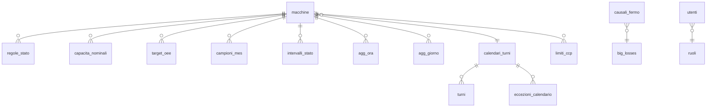

# 02 — Modello dati e definizioni KPI

Stato: **approvata il 05/11/2026** con le decisioni in §12 (punti 6 e 7 restano aperti, con il default prudente)
Base: `docs/01_mappa_db.md` (approvata), strada **A** (storico HIST di `FPROCESSDATA`).

Legenda: `[DA VERIFICARE]` = assunzione da confermare; **(Admin)** = parametro gestito nella dashboard.

## 0. Piano della Fase 2

1. Definire **come si ricava lo stato** (in funzione / non in funzione / senza dato) per ogni macchina dai campioni a 15 minuti.
2. Definire come un campione si trasforma in **intervalli di tempo**, gestendo buchi, fuso orario e cambio d'ora.
3. Definire il primo KPI: **ore in funzione al giorno** e utilizzo.
4. Definire Disponibilità, Prestazione, Qualità e OEE, con le regole di aggregazione pesata.
5. Indicare per ogni KPI e per ogni macchina **cosa è calcolabile oggi** e cosa manca.
6. Impostare perdite, MTBF/MTTR e CCP come struttura, da attivare più avanti.
7. Scrivere le **query di origine** sul MES: parametrizzate, su indice, senza `SELECT *`.
8. Definire lo **schema del DB applicativo** MySQL (aggregati, configurazione storicizzata, audit).
9. Preparare i **casi di test** con calcolo a mano.

---

## 1. Principi

1. **Dato oggettivo prima di tutto.** Il primo prodotto della dashboard è una fotografia di quanto ogni macchina lavora, ricavata **solo** dai campioni FDI. I parametri inseriti a mano (turni, capacità, causali) arricchiscono i KPI ma non modificano il dato misurato.
2. **"Non disponibile" non vale 100% né 0%.** Se un fattore non è calcolabile, il KPI è mostrato come **n.d. con il motivo**. Non si sostituisce mai un valore mancante con un default.
3. **Senza dato non significa fermo.** Un periodo senza campioni FDI è classificato `SENZA_DATO` ed escluso dai calcoli, ma è sempre mostrato. La dashboard indica sempre la **copertura dati**.
4. **Tracciabilità.** Ogni intervallo conserva la chiave del record di origine (`FOBJECT`, `FCHANNEL`, `FTIMESTAMP`, `FROW`) e il **valore originale in testo**.
5. **Regole versionate.** Soglie e regole di stato sono configurazioni **(Admin)** con validità dal/al. Ogni aggregato registra la versione di regole usata, e un ricalcolo è sempre ripetibile.

---

## 2. Dal campione allo stato macchina

### 2.1 Stati usati dalla dashboard

| Codice | Significato | Conta come tempo di marcia? |
|---|---|---|
| `MARCIA` | la macchina sta lavorando | sì |
| `FERMO` | accesa o pronta ma non produce | no |
| `ALLARME` | stato di errore o emergenza dichiarato dalla macchina | no (perdita "guasto") |
| `AVVIO` | configurazione, connessione, caricamento ricetta o dati, setup | no (perdita "setup/avviamento") |
| `RISCALDAMENTO` / `RAFFREDDAMENTO` | transitori termici del forno | no, conteggiati a parte |
| `NON_CLASSIFICATO` | dato presente ma di significato ignoto (es. FX10130 `End3`) | escluso dal calcolo come `SENZA_DATO`, ma mostrato a parte |
| `SENZA_DATO` | nessun campione valido | escluso dal calcolo |

### 2.2 Regole di stato per macchina (Admin, valori iniziali proposti)

Le regole sono valutate in ordine; vale la prima che corrisponde.

**FX10130 — Selezionatrice Fenix** (fonte: `FVALUE01` = `CurrentSmState`, manuale 3UVision)

| `FVALUE01` | Stato |
|---|---|
| `Selecting` | `MARCIA` |
| `Cleaning` | `MARCIA` (confermato) |
| `Ready` | `FERMO` |
| `ReadyError`, `SelectionError`, `CleaningError`, `RecipeError`, `ConnectError`, `ConfigureError`, `MachineDataError`, `Emergency` | `ALLARME` |
| `Configure`, `Connect`, `MachineData`, `Recipe`, `Setup`, `FwUpgrade` | `AVVIO` |
| `Offline` | `FERMO` |
| `End3` | `NON_CLASSIFICATO` (decisione 05/11/2026; il significato verrà fornito) |
| `CleaningMachine` | `FERMO` (confermato) |
| `Testing` | `AVVIO` (confermato) |
| `ReadyCheck` | `FERMO` (confermato) |
| `OfflineOrDisabled` | `FERMO` (variante di `Offline`) |
| vuoto o valore non previsto | `SENZA_DATO`, segnalato come "valore non mappato" |

> FDI usa `Active` per lo stato (anomalia A10). La dashboard **non** usa quel calcolo.

**FORNOKING500 — Forno King 500**

Il forno **non espone un segnale di marcia** (anomalia A9: `FVALUE07` è lo stato ordine, sempre 0). Lo stato si deduce dalla **temperatura di tostatura** `FVALUE02` (`Temp_Toasting`), con due soglie **(Admin)** decise il 05/11/2026:

| Condizione | Stato |
|---|---|
| `FVALUE02` ≥ **S_marcia = 100 °C** | `MARCIA` ("forno in temperatura di lavoro") |
| **S_transitorio = 70 °C** ≤ `FVALUE02` < 100 °C, temperatura **in salita** rispetto al campione precedente | `RISCALDAMENTO` |
| 70 °C ≤ `FVALUE02` < 100 °C, temperatura **in discesa** | `RAFFREDDAMENTO` |
| 70 °C ≤ `FVALUE02` < 100 °C, temperatura invariata o primo campione | stesso transitorio del campione precedente; se manca, `RISCALDAMENTO` se il campione precedente era sotto 70 °C, `RAFFREDDAMENTO` se era sopra 100 °C |
| `FVALUE02` < 70 °C | `FERMO` |
| `FVALUE02` vuoto o non numerico | `SENZA_DATO` |

- **Riscaldamento e raffreddamento** non contano come marcia, ma sono conteggiati e mostrati **separatamente**: ore al giorno, numero di avviamenti, durata media del riscaldamento.
- Possibile limite: la fascia 90–100 °C ha molti campioni (1.584 in 12 mesi). Potrebbe esserci una ricetta che lavora sotto i 100 °C, per esempio un'asciugatura, e verrebbe contata come transitorio. `[DA VERIFICARE guardando qualche giornata]`
- **Limite noto**: un forno "in temperatura" può essere in preriscaldo o a vuoto. Il KPI va quindi letto come **ore con forno in temperatura di lavoro**.

**HYPERSORTL4**: **fuori perimetro** (decisione del 05/11/2026).

**BROVRAF — Raffinatrice** (fonte: `FVALUE07`/`FVALUE08` = velocità motore 1/2)

| Condizione | Stato |
|---|---|
| `FVALUE07` > 0 oppure `FVALUE08` > 0 | `MARCIA` `[DA VERIFICARE]` |
| entrambi = 0 | `FERMO` |

> Dal 13/05/2025 tutti i valori sono 0 (anomalia A3). Con questa regola la macchina risulterebbe sempre ferma, anche se forse il PLC è solo scollegato. Proposta: finché A3 non è chiarita, la macchina è marcata **"dati non affidabili"** e i KPI non vengono pubblicati.

### 2.3 Dal campione all'intervallo

FDI scrive una riga ogni 15 minuti (`TIMERHIST` = 900 s) con i valori **istantanei** di quel momento.

- Il campione al tempo `t` rappresenta l'intervallo **[t, t_succ)**, dove `t_succ` è il campione successivo della stessa macchina.
- **Caso normale: record presente ma campi vuoti.** FDI scrive un record ogni 15 minuti anche quando la macchina non comunica (es. HYPERSORTL4 dal 28/01/2026). Se il campo usato dalla regola di stato è **vuoto o non valido**, l'intervallo è `SENZA_DATO`.
- **Caso raro: record mancante.** Si è già visto per FX10130, con 52 righe in 7 giorni invece di 672. Se `t_succ − t` > **G_max** (Admin, **20 minuti**), il campione copre solo [t, t + 15 min) e il resto è `SENZA_DATO`.
- **Incertezza**: ogni cambio di stato è noto con un'approssimazione **fino a 15 minuti**. La dashboard lo dichiara nel tooltip ("risoluzione 15 min").
- **Fuso orario**: `FTIMESTAMP` è ora locale senza offset. Viene convertito in UTC con il fuso Europe/Rome. Nell'ora ripetuta di fine ottobre l'ambiguità si risolve con l'ordine dei campioni (`FTIMESTAMP`, `FROW`). Si conservano sia il valore originale sia quello UTC; la visualizzazione è sempre in Europe/Rome.
- **Numeri in testo**: `FVALUEnn` usa la virgola decimale. La conversione sostituisce `,` con `.` e converte in `DECIMAL(15,5)` **senza arrotondare**, conservando il testo originale. Se la conversione fallisce, lo stato del campione è `SENZA_DATO` e il campione viene segnalato.

---

## 3. KPI di base: tempo in funzione (disponibile da subito)

| KPI | Formula | Note |
|---|---|---|
| **Ore in funzione** | Σ durata intervalli `MARCIA` | per macchina, ora, giorno, settimana, mese |
| Ore ferma / allarme / avvio | Σ durata intervalli del rispettivo stato | |
| **Copertura dati** | (24 h − ore `SENZA_DATO`) / 24 h | campioni presenti / attesi (96 al giorno) |
| **Utilizzo su calendario** | ore in funzione / 24 h | non richiede turni |
| **Utilizzo su tempo coperto** | ore in funzione / (24 h − ore `SENZA_DATO`) | da affiancare sempre alla copertura |

È la "prima fotografia" richiesta: per ogni giorno, quante ore ha lavorato la macchina secondo i dati FDI.

---

## 4. OEE

### 4.1 Tempo pianificato (Admin)

```
Tempo pianificato = Σ ore dei turni del calendario (Admin)
                    − pause programmate (Admin)
                    − fermi programmati (Admin: manutenzione, pulizia, festività)
                    − assenza ordini (Admin, se dichiarata)
```

- Finché il calendario non è configurato, la Disponibilità è **n.d.** e si mostra solo l'Utilizzo su calendario (§3).
- La marcia **fuori turno** (es. di notte) non entra nella Disponibilità, ma viene mostrata come indicatore separato "ore in funzione fuori turno".
- Il tempo `SENZA_DATO` dentro il turno è escluso sia dal numeratore sia dal denominatore, e la copertura del turno è mostrata accanto.

### 4.2 Fattori

| Fattore | Formula | Fonte |
|---|---|---|
| **Disponibilità (D)** | marcia nel turno / (tempo pianificato − senza dato nel turno) | stato (§2) + calendario (Admin) |
| **Prestazione (P)** | produzione effettiva / (capacità nominale × marcia nel turno) | contatori + capacità kg/h (Admin) |
| **Qualità (Q)** | produzione conforme / produzione totale | contatori o dichiarazioni (Admin) |
| **OEE** | D × P × Q | |

La Prestazione richiesta dal prompt, (pezzi × tempo ciclo ideale) / tempo di marcia, è equivalente a produzione / (capacità × marcia), con capacità = 1 / tempo ciclo ideale. Per prodotti sfusi si usano i kg/h.

### 4.3 Aggregazione (pesata, mai media delle percentuali)

Per qualunque insieme di periodi o turni si sommano prima le grandezze, poi si calcola il rapporto:

```
D = Σ marcia_i / Σ pianificato_netto_i
P = Σ produzione_i / Σ (capacità_i × marcia_i)
Q = Σ conformi_i / Σ totale_i
OEE = D × P × Q
```

Questo equivale a pesare l'OEE di ogni periodo sul tempo pianificato.

### 4.4 Cosa è calcolabile oggi, per macchina

| Macchina | Ore in funzione | D | P | Q | OEE | Note |
|---|---|---|---|---|---|---|
| FX10130 | ✅ | ✅ con turni (Admin) | ✅ con capacità (Admin) | ⚠️ vedi sotto | ⚠️ | campioni irregolari (A5): copertura da mostrare |
| FORNOKING500 | ✅ (proxy temperatura) | ✅ con turni | ❌ nessuna quantità | ❌ | ❌ → solo D | quantità da registrazioni manuali (parcheggiate) |
| BROVRAF | ⏸ sospesa | — | ❌ | ❌ | ❌ | anomalia A3, da rivedere più avanti |

**FX10130, produzione e qualità**
- **Produzione in ingresso** = Δ(`FNVALUE04` + `FNVALUE06`) + Δ(`FNVALUE03` + `FNVALUE05`), cioè kg selezionati più kg scartati delle sezioni 1 e 2. Si usano le sezioni, non i totali `FNVALUE07`/`08`, per l'anomalia A2.
- **Δ dei contatori**: differenza tra campioni consecutivi. Se la differenza è **negativa** (azzeramento `DO_RESET_PRODUCT`, A11), si assume Δ = valore nuovo e il campione viene segnalato come "reset contatore".
- I kg della selezionatrice sono **indicativi, senza valore fiscale** (manuale 3UVision): va scritto nel tooltip.
- **Qualità**: in una selezionatrice il prodotto scartato è il **risultato del suo lavoro** (rimozione dei difetti dal prodotto in ingresso), non uno scarto generato dalla macchina. Proposta: **Q = n.d.** finché non definite cosa è "non conforme" per la selezionatrice. Il **% scarto di selezione** si mostra come indicatore di processo separato, non come Qualità OEE. `[DA VERIFICARE]`

### 4.5 Perdite (6 big losses)

Mancano le causali di fermo, quindi per ora la classificazione è solo quella ricavabile dallo stato:

| Big loss | Fonte oggi |
|---|---|
| Guasti | stato `ALLARME` (solo FX10130) |
| Setup e regolazioni | stato `AVVIO` (solo FX10130) |
| Micro-fermate e attese | stato `FERMO` (non distinguibile sotto i 15 min) |
| Velocità ridotta | P < 100% (solo FX10130) |
| Scarti e rilavorazioni | n.d. |
| Avviamento | n.d. |

Le **causali di fermo (Admin)** sono già previste nel DB applicativo, con la mappatura causale → big loss. L'assegnazione delle causali ai fermi arriverà con le registrazioni manuali (parcheggiate).

### 4.6 MTBF / MTTR

- Formule: **MTBF** = tempo di marcia / n° di fermate per guasto; **MTTR** = Σ durata dei guasti / n° di guasti.
- Calcolabili solo per FX10130, dalle transizioni verso `ALLARME`.
- Con una risoluzione di 15 minuti i guasti brevi non si vedono. Proposta: **non pubblicarli** finché non ci sono dati più fini o registrazioni manuali. In alternativa si possono pubblicare con l'etichetta "indicativo, risoluzione 15 min".

---

## 5. CCP (struttura, da attivare dopo l'OEE)

Si predispone solo la struttura. Contenuti e limiti verranno definiti con la Qualità.

- **Misura**: valore originale (testo) e valore convertito di una variabile in `FPROCESSDATA`, per esempio forno `FVALUE02` (tostatura) o `FVALUE05`/`FVALUE06` (prodotto). Si mostra **come registrato**, con timestamp originale.
- **Limiti (Admin)**: per macchina, variabile e, se necessario, ricetta. Comprendono limite critico inferiore/superiore, limiti di allerta, frequenza attesa e validità dal/al, tutti storicizzati.
- **Esito**: conforme se LCI ≤ valore ≤ LCS. **Un valore pari al limite è conforme** `[DA VERIFICARE con la Qualità]`.
- **Misura mancante**: un campione atteso, secondo la frequenza, non presente mentre la macchina è in `MARCIA`.
- **KPI**: n° misure, % conformi, n° deviazioni, tempo medio di chiusura della deviazione (registro deviazioni nel DB applicativo), misure mancanti.
- **Limite noto**: la ricetta in uso nel forno non è nello storico, quindi i limiti per ricetta non sono applicabili automaticamente.

---

## 6. Dati mancanti e assunzioni, riepilogo

| Dato | Stato | Gestione |
|---|---|---|
| Stato marcia forno | assente | proxy temperatura, soglia **(Admin)** |
| Turni / calendario | assente nel MES | **(Admin)** |
| Capacità nominale kg/h | assente | **(Admin)**, storicizzata |
| Causali di fermo | assenti | **(Admin)**, assegnazione parcheggiata |
| Quantità forno e raffinatrice | assenti | registrazioni manuali (parcheggiate) |
| Definizione di qualità per la selezionatrice | da decidere | Q = n.d. |
| Limiti CCP | assenti | **(Admin)**, fase successiva |
| Target OEE | assente | **(Admin)** |

---

## 7. Query di origine sul MES (sola lettura)

Regole comuni:
- solo `SELECT` parametrizzate (`?`), con colonne esplicite;
- ricerca sull'indice cluster `FOBJECT, FOBJTYPE, FCHANNEL, FTIMESTAMP`;
- isolamento **READ COMMITTED** (default), per non leggere righe non confermate;
- `LOCK_TIMEOUT` 5 s e timeout di comando 30 s; utente `lettore`.

**Q1 — Estrazione incrementale per macchina** (job **ogni 15 minuti**, la stessa frequenza con cui FDI scrive; parametri: macchina, ultimo `FTIMESTAMP` già importato)
```sql
SELECT FOBJECT, FCHANNEL, FTIMESTAMP, FROW, FBATCH,
       FVALUE01, FVALUE02, FVALUE03, FVALUE04, FVALUE05, FVALUE06, FVALUE07,
       FVALUE08, FVALUE09, FVALUE10, FVALUE11,
       FNVALUE01, FNVALUE02, FNVALUE03, FNVALUE04, FNVALUE05, FNVALUE06,
       FNVALUE07, FNVALUE08, FNVALUE09, FNVALUE10, FNVALUE11, FNVALUE12
FROM dbo.FPROCESSDATA
WHERE FOBJECT = ? AND FOBJTYPE = 'MAC' AND FCHANNEL = 'HIST'
  AND FTIMESTAMP > ?
ORDER BY FTIMESTAMP, FROW;
```
Per ogni macchina si leggono solo le colonne della sua mappa (§4 della mappa DB). L'elenco sopra è l'unione delle colonne.

**Q2 — Caricamento storico iniziale** (una tantum, di notte, a blocchi mensili)

È la stessa query di Q1, con `FTIMESTAMP >= ? AND FTIMESTAMP < ?` (inizio e fine del mese). Carico stimato: circa 2.900 righe al mese per macchina.

**Q3 — (eliminata).** Decisione del 05/11/2026: il MES non va sollecitato oltre il necessario. La vista "Stato macchine" usa **l'ultimo campione HIST** già importato da Q1, con un ritardo massimo di circa 15 minuti, e mostra "dati aggiornati alle hh:mm". La pagina si aggiorna ogni 60 s leggendo **solo il DB applicativo**.

**Q4 — Esplorazione per la soglia del forno** (una tantum, eseguita dallo script di scoperta, non dall'app)
```sql
SELECT CAST(FTIMESTAMP AS date) AS giorno,
       FLOOR(TRY_CONVERT(decimal(9,2), REPLACE(FVALUE02, ',', '.')) / 10) * 10 AS fascia_10C,
       COUNT(*) AS campioni
FROM dbo.FPROCESSDATA
WHERE FOBJECT = 'FORNOKING500' AND FOBJTYPE = 'MAC' AND FCHANNEL = 'HIST'
  AND FTIMESTAMP >= ? AND FTIMESTAMP < ?
GROUP BY CAST(FTIMESTAMP AS date),
         FLOOR(TRY_CONVERT(decimal(9,2), REPLACE(FVALUE02, ',', '.')) / 10) * 10
ORDER BY giorno, fascia_10C;
```

---

## 8. Schema del DB applicativo (MySQL 8.4)

Convenzioni:
- tempi in UTC (`DATETIME(3)`), con il valore originale accanto;
- configurazioni con `valido_dal`/`valido_al` e `aggiornato_da`/`aggiornato_il`;
- ogni modifica di configurazione è scritta in `audit_modifiche`.



| Tabella | Contenuto principale |
|---|---|
| `macchine` | codice MES (`FOBJECT`), descrizione, attiva, `calendario_id`, flag "dati non affidabili" con motivo |
| `regole_stato` | macchina, ordine, colonna sorgente, operatore (`=`, `IN`, `>=`, `<`, `≠`, vuoto), valore o soglia, stato risultante, validità, versione |
| `parametri_macchina` | `G_max` (min), soglia forno, ecc. con validità |
| `capacita_nominali` | macchina, kg/h, validità |
| `calendari_turni`, `turni` | nome turno, giorno della settimana, ora inizio/fine, pause |
| `eccezioni_calendario` | data, macchina o tutte, tipo (festivo, fermo programmato, assenza ordini), ore |
| `target_oee` | macchina, target OEE / D / P / Q, validità |
| `big_losses`, `causali_fermo` | anagrafica delle causali con mappatura sulle 6 big losses (assegnazione parcheggiata) |
| `campioni_mes` | copia **fedele** delle righe Q1: chiave di origine (`fobject`, `fchannel`, `ftimestamp_originale`, `frow`), `ts_utc`, valori **testo originale** e convertiti, flag anomalie (non numerico, reset contatore, valore non mappato). Univoca sulla chiave di origine, quindi le importazioni ripetute sono sicure. |
| `intervalli_stato` | macchina, inizio e fine UTC, stato, riferimento al campione di origine, versione regole |
| `agg_ora`, `agg_giorno` | macchina, periodo, turno, secondi per stato, secondi pianificati, secondi senza dato, kg in/sel/scart, D/P/Q/OEE (NULL = n.d.) con motivo, versione regole, calcolato_il |
| `sync_mes` | per macchina: ultimo `FTIMESTAMP` importato, ultima esecuzione, esito, errore (per l'avviso "MES non risponde") |
| `limiti_ccp`, `deviazioni_ccp`, `azioni_correttive` | struttura CCP (fase successiva) |
| `utenti`, `ruoli`, `inviti` | SuperAdmin, Admin, Direzione, Qualità; inviti con token monouso e scadenza |
| `audit_modifiche` | chi, quando, tabella, record, valore precedente, valore nuovo |
| `log_accessi`, `log_export` | chi, cosa, quando, filtri applicati (NIS2) |

Job:
- **ogni 15 minuti**: Q1 per macchina (3 query di poche righe), inserimento in `campioni_mes`, ricalcolo di intervalli e aggregati delle ore toccate;
- **ogni notte**: ricalcolo degli ultimi 7 giorni, per righe arrivate in ritardo o regole modificate;
- **su richiesta di un Admin**: ricalcolo storico dopo un cambio di regole.

Volume stimato: ~35.000 campioni l'anno per macchina, quindi le viste sui 12 mesi leggono solo `agg_giorno` e restano sotto i 3 secondi.

---

## 9. Casi di test con calcolo a mano (da implementare in Fase 4)

**T1 — Intervalli da campioni (G_max = 20 min).** Campioni FX10130 alle 08:00 `Selecting`, 08:15 `Selecting`, 08:30 `Ready`, 08:45 nessun campione, 09:10 `Selecting`, 09:25 `Selecting`. Fine del periodo: 09:40.
- 08:00–08:15 marcia (15), 08:15–08:30 marcia (15).
- 08:30 → 09:10 sono 40 min > G_max: 08:30–08:45 fermo (15), 08:45–09:10 senza dato (25).
- 09:10–09:25 marcia (15), 09:25–09:40 marcia (15).
- **Marcia 60 min, fermo 15, senza dato 25.** Copertura = 75/100 = 75%. Utilizzo su tempo coperto = 60/75 = **80%**.

**T2 — OEE di un turno.** Turno 07–16 (9 h), pausa 1 h, quindi pianificato 8 h = 480 min, senza dato 0. Marcia 360 min. Capacità 600 kg/h. Kg in ingresso 3.000. Q considerata 98% (solo per il test).
- D = 360/480 = 0,75.
- P = 3.000 / (600 × 6) = 3.000/3.600 = 0,8333.
- OEE = 0,75 × 0,8333 × 0,98 = **0,6125** (61,25%).

**T3 — Aggregazione pesata.** Giorno 1: pianificato 480, marcia 360 (D = 75%). Giorno 2: pianificato 240, marcia 216 (D = 90%).
- Corretto: D = 576/720 = **80,0%**.
- Media semplice (sbagliata): 82,5%. Il test deve fallire se si usa la media.

**T4 — Reset contatore.** `FNVALUE04` (kg selezionati S1): 100, 150, 20, 60.
- Δ = 50, poi −130 → reset → 20, poi 40.
- **Totale = 110 kg**, con 1 segnalazione di reset.

**T5 — Conversione senza arrotondamento.** `"42,2"` → 42.20000; `"139,85"` → 139.85000; `"3,97 bar"` → non numerico → `SENZA_DATO` e segnalazione. Il testo originale resta conservato.

**T6 — Limite CCP** (fase successiva). Con LCI = 140,0: 140,0 → conforme; 139,9 → non conforme; campione mancante con forno in marcia → "misura mancante".

---

## 10. Decisioni richieste per approvare la Fase 2

1. **Regole di stato FX10130**: va bene `Selecting` (e `Cleaning`) = marcia, `Ready` = fermo, `…Error`/`Emergency` = allarme?
2. **Forno**: confermate l'approccio "in funzione = temperatura di tostatura ≥ soglia"? Procedo con la query Q4 per scegliere la soglia sui dati reali?
3. **HYPERSORTL4**: `STATO` ≠ 0 = marcia va bene? Avete il manuale Cimbria?
4. **BROVRAF**: confermate di sospendere i KPI finché non si chiarisce perché i dati sono a 0 da maggio 2025?
5. **G_max = 20 minuti** per considerare un buco "senza dato": va bene?
6. **Qualità della selezionatrice**: confermate Q = n.d., con il % scarto di selezione mostrato a parte?
7. **MTBF/MTTR**: non pubblicati finché i dati sono a 15 minuti, oppure pubblicati con l'etichetta "indicativo"?
8. **Frequenza del job** di estrazione ogni 5 minuti e vista "Stato macchine" ogni 60 s (letture minime): va bene per il MES?

## 11. Sviluppi parcheggiati

- **Registrazioni manuali degli operatori** (timestamp disponibili): servono per quantità del forno, causali di fermo e conferma degli stati. Da esplorare dopo i primi dati di OEE.
- **Richieste a Qualitas e Brovind**: frequenza HIST più alta, storicizzazione di `Time_Permanence`, `BulkHead_Opening` e ricetta; correzione delle anomalie A1–A5, A9 e A10.
- **CCP**: definizione con la Qualità (§5).

## 12. Decisioni del 05/11/2026

| # | Tema | Decisione |
|---|---|---|
| 1 | Regole FX10130 | Confermate; **`Cleaning` = marcia** |
| 2 | Forno | Confermato "in funzione = temperatura di tostatura ≥ soglia". Soglia da scegliere con Q4 (`discovery/sql_giro4`) |
| 3 | HYPERSORTL4 | **Fuori perimetro** |
| 4 | BROVRAF | **Sospesa**, da rivedere più avanti |
| 5 | Buchi | FDI scrive un record ogni 15 min, ma con **campi vuoti**: campi vuoti = `SENZA_DATO`. Resta anche la regola dei 20 minuti per i record mancanti |
| 6 | Qualità selezionatrice | **Aperta**: per ora Q = n.d. e OEE FX10130 = n.d.; si mostrano D, P e % scarto di selezione |
| 7 | MTBF/MTTR | **Non pubblicati** per ora (vedi spiegazione sotto) |
| 8 | Carico MES | Nessuna lettura in tempo reale: **una lettura ogni 15 minuti per macchina** (Q1), il resto dal DB applicativo |

**MTBF / MTTR in breve**
- **MTBF** (tempo medio tra guasti) = ore di marcia / numero di guasti. Indica ogni quanto, in media, la macchina si guasta.
- **MTTR** (tempo medio di riparazione) = ore totali di guasto / numero di guasti. Indica quanto dura in media un guasto.

Servono a valutare affidabilità e manutenzione. Con campioni ogni 15 minuti i guasti brevi non si vedono, quindi i valori sarebbero fuorvianti: si attivano quando ci saranno dati più fini o le registrazioni manuali.

## 13. Esito del giro 4 (05/11/2026, ultimi 12 mesi)

### Forno: distribuzione di `FVALUE02` (temperatura di tostatura)
Campioni per fascia di 10 °C:

| °C | 0 | 10 | 20 | 30 | 40 | 50 | 60 | 70 | 80 | 90 | 100 | 110 | 120 | 130 | 140 | 150 | 160 |
|---|---|---|---|---|---|---|---|---|---|---|---|---|---|---|---|---|---|
| campioni | 188 | 6.165 | 7.066 | 3.807 | 2.540 | 1.779 | 1.006 | 734 | 737 | 1.584 | 1.393 | 1.714 | 1.441 | 1.025 | 2.461 | 1.342 | 2 |

- La distribuzione ha **due gruppi**: forno freddo (10–40 °C) e forno in lavoro (90–150 °C), con un minimo a 70–80 °C dovuto ai transitori di riscaldamento e raffreddamento.
- Molte giornate lavorano con un massimo a 110–120 °C, cioè ricette a temperatura più bassa (es. asciugatura, mandorle).
- Le domeniche risultano a 0 ore con qualunque soglia. Questo conferma che il segnale distingue bene forno acceso e spento.
- Copertura: 56 campioni vuoti in 12 mesi (luglio 2026), nessun valore non numerico.

| Soglia S_marcia | Giorni con funzionamento | Media ore/giorno (giorni attivi) | Effetto |
|---|---|---|---|
| 80 °C | 276 | 10,6 h | include buona parte di riscaldamento e raffreddamento |
| **100 °C** (proposta) | 274 | 8,6 h | include le ricette a 110–120 °C ed esclude la maggior parte dei transitori |
| 130 °C | 197 | 6,1 h | perde le giornate con ricette a bassa temperatura: sottostima |

### FX10130: valori di `CurrentSmState` e copertura
| Stato | Campioni | Ore circa |
|---|---|---|
| Ready | 4.923 | 1.231 |
| **End3** (non nel manuale) | 4.188 | 1.047 |
| Selecting | 4.016 | 1.004 |
| Cleaning | 243 | 61 |
| (vuoto) | 59 | 15 |
| CleaningMachine | 51 | 13 |
| ReadyError 21, Testing 9, SelectionError 5, ReadyCheck 3, CleaningError 2, Recipe 2, OfflineOrDisabled 1 | | |

- **Copertura molto discontinua**: nessun record tra **febbraio e maggio 2026**, mesi parziali da giugno a ottobre 2026 (8–28 giorni con dati). Il connettore OPC di FX10130 perde la comunicazione per periodi lunghi `[DA VERIFICARE con Qualitas]`. La dashboard mostrerà questi periodi come `SENZA_DATO`.

## 14. Decisioni del 05/11/2026 (dopo il giro 4)

| Tema | Decisione |
|---|---|
| Forno | `MARCIA` ≥ 100 °C; **transitori 70–100 °C conteggiati a parte** (riscaldamento / raffreddamento); `FERMO` < 70 °C |
| FX10130 `End3` | `NON_CLASSIFICATO` finché non arriva il significato |
| FX10130 altri stati | proposte confermate |
| Copertura discontinua FX10130 | da verificare con Qualitas |

## 15. Decisione del 06/11/2026 — BROVRAF

Il giro 5 ha trovato uno storico valido di BROVRAF da gennaio 2024 a maggio 2025 (nel 2024 un campione al minuto); dal 13/05/2025 i valori sono tutti a 0 (PLC che non comunica).
**Decisione: BROVRAF è fuori perimetro** e resta disattivata. Nel codice è presente la regola `soglia_colonne` (velocità motore > 0; temperature tutte a 0 = senza dato), riattivabile dal pannello Configurazione se servisse in futuro.
